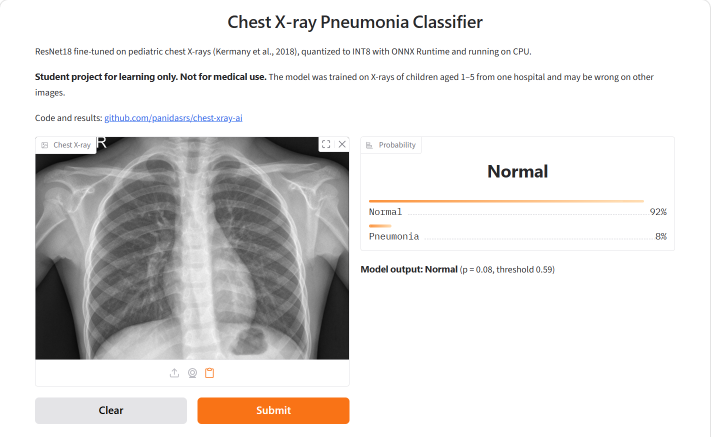
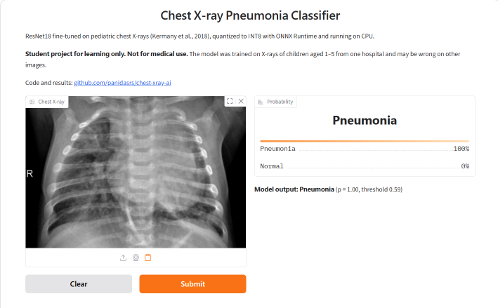
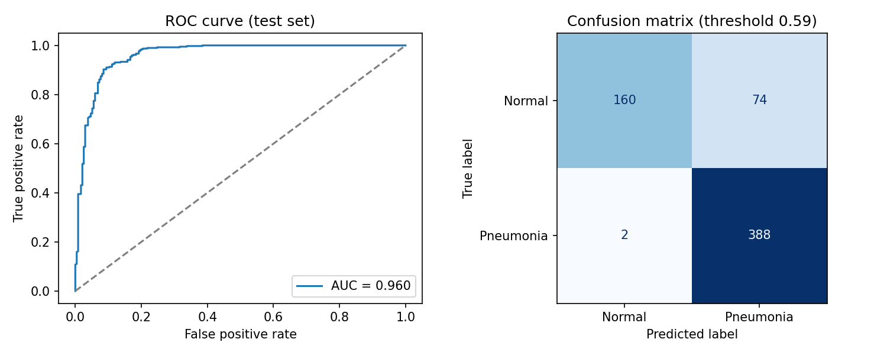
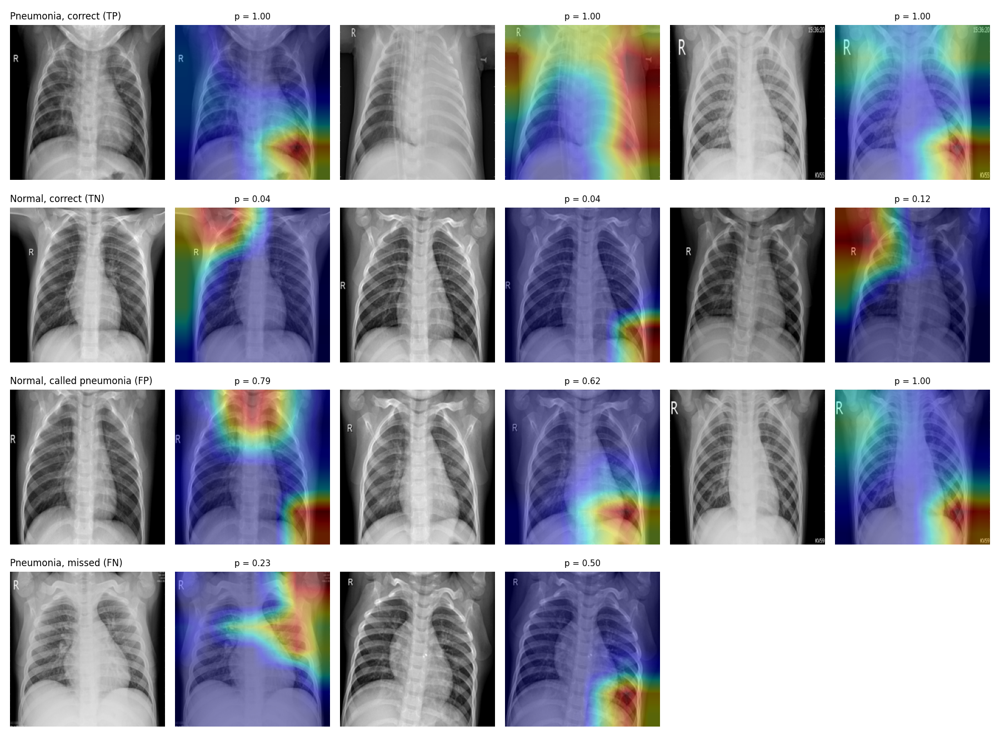

# Chest X-ray Pneumonia Classifier

A ResNet18 model that classifies pediatric chest X-rays as **normal** or **pneumonia**.
The plan is to make it run fast on a normal laptop CPU (ONNX + INT8) and put up a small web demo.

**Live demo:** [huggingface.co/spaces/Mhiu/chest-xray-ai](https://huggingface.co/spaces/Mhiu/chest-xray-ai) (INT8 ONNX model, upload an X-ray)

 

**This is a student project for learning. It is not for medical use.**

## Problem

Pneumonia is one of the leading causes of death in children under 5 worldwide (WHO). A chest X-ray is the usual
way to confirm it, but reading X-rays needs a radiologist, and in many hospitals there are not enough of them,
so images can wait a long time before anyone looks at them.

This project builds an image classifier that looks at a pediatric chest X-ray and outputs the probability of
**pneumonia** vs **normal**. The idea is to use it as a **triage / second-reader tool**: X-rays the model flags as
likely pneumonia can be moved to the front of the radiologist's queue. The model never makes the final decision.

Because missing a sick child is worse than a false alarm, I focus on **sensitivity** (how many pneumonia cases are
caught) together with **specificity** and AUC, not only accuracy. I also make the model small and fast enough to run
on an ordinary CPU (ONNX + INT8), since many clinics don't have a GPU.

## Progress

- [x] Data preparation (patient-level split) and EDA
- [x] Baseline model: ResNet18 fine-tuned from ImageNet weights (test AUC 0.960)
- [x] Grad-CAM to see where the model looks
- [x] Compare 4 models (ResNet18 / EfficientNet-B0, stretch / pad)
- [x] Export to ONNX and quantize to INT8
- [x] Compare speed and size on CPU
- [x] Gradio demo on Hugging Face Spaces

## Results

Official test set (624 images):

| Model | AUC | Sensitivity | Specificity | Accuracy |
|---|---|---|---|---|
| ResNet18 baseline | 0.960 | 0.995 | 0.684 | 0.878 |

Threshold 0.59 (chosen on validation). Out of 390 pneumonia cases the model missed 2;
out of 234 normal cases, 74 were flagged as pneumonia.



What I noticed:

- **Validation vs test gap.** Validation AUC was 0.9995 but test AUC was 0.960. Since train and validation are split
  by patient, this is not leakage — the official test images seem to look different from the training images
  (distribution shift). This is a real problem for medical AI, e.g. when a model moves to a different hospital.
- **Too many false positives on test.** The threshold picked on validation doesn't transfer perfectly, so
  specificity drops to 68%. For screening, missing only 2 sick children is good, but this is something to improve.
- **Learns very fast.** Validation AUC was already 0.9995 after the first epoch, so the validation set is
  almost too easy to compare epochs.

## EDA

See [`notebooks/eda.ipynb`](notebooks/eda.ipynb). Main findings:

- Train/val have about 74% pneumonia, but the test set only 62.5%.
- Normal images are much bigger (median 1654x1323) than pneumonia images (median 1160x776) and have a different
  shape (width/height 1.2 vs 1.5). Stretching every image to 224x224 squashes the two classes differently,
  so the model could learn the image shape instead of the disease.
- Mean brightness is almost the same for both classes (123.0 vs 122.7).

## Model comparison

To test the image-shape idea from the EDA, I trained 3 more models
([`notebooks/compare_models_colab.ipynb`](notebooks/compare_models_colab.ipynb)).
`pad` adds black borders to make the image square instead of stretching it.
Official test set, threshold chosen on validation:

| Run | Model | Resize | AUC | Sensitivity | Specificity | FN | FP | Threshold |
|---|---|---|---|---|---|---|---|---|
| baseline | ResNet18 | stretch | 0.960 | 0.995 | 0.684 | 2 | 74 | 0.59 |
| resnet18_pad | ResNet18 | pad | 0.969 | 0.997 | 0.667 | 1 | 78 | 0.26 |
| effnet_stretch | EfficientNet-B0 | stretch | 0.972 | 0.992 | 0.667 | 3 | 78 | 0.27 |
| effnet_pad | EfficientNet-B0 | pad | 0.963 | 0.997 | 0.692 | 1 | 72 | 0.63 |

What I noticed:

- **All 4 models are very close** (AUC 0.960–0.972). With one training run each and 624 test images,
  differences of about 0.01 are probably noise.
- **Padding did not fix the false positives.** FP stayed at 72–78 for every model, and padding helped ResNet18's AUC
  but hurt EfficientNet's. So the image-shape shortcut is not the main reason for the low specificity.
- **The threshold is unstable.** The best threshold on validation jumps between 0.26 and 0.63 across models,
  because validation AUC is almost 1.0 (many thresholds look equally good there). Together with the different
  class mix in the test set, this is a more likely reason why specificity is only ~0.68.
- I kept the **ResNet18 baseline** for the demo: the others are not clearly better, and Grad-CAM and the
  ONNX/INT8 work were already done on it.

## Grad-CAM: where does the model look?

`gradcam.py` draws a heatmap of the image areas that pushed the model towards "pneumonia"
(3 random test images per group, threshold 0.59).



What I noticed:

- In many images the hottest area is **not inside the lungs**: image borders, the black background,
  the neck, and corners near the "R" marker or scanner text (e.g. "KV59").
- A common hot spot is the lower right of the image (the patient's left lung base, near the heart and diaphragm).
  Sometimes this is inside the lung, sometimes it is below it.
- This suggests the model may partly use **shortcuts** (things that differ between images but are not the disease),
  which could also explain the many false positives on the test set.

Limits: this is only 11 images, the Grad-CAM map is very coarse (7x7 grid for ResNet18), and I am not a radiologist,
so this is a warning sign to check, not a proof.

## ONNX + INT8 on CPU

`export_onnx.py` converts the model to ONNX and makes an INT8 version with static quantization
(calibrated on 100 validation images). `benchmark.py` measures each version on CPU
(batch size 1, average of 100 runs) and re-checks test AUC.

| Version | Size | Time per image | Test AUC |
|---|---|---|---|
| PyTorch FP32 | 44.8 MB | 97.6 ms | 0.960 |
| ONNX FP32 | 44.7 MB | 62.2 ms | 0.960 |
| ONNX INT8 | 11.3 MB | 41.0 ms | 0.963 |

Measured on a Google Colab CPU runtime.

- INT8 is **4x smaller** and **2.4x faster** than PyTorch (1.5x faster than ONNX FP32).
- Test AUC did not drop. The small increase (0.960 → 0.963) is just rounding noise, not a real improvement.

## Dataset

[Chest X-Ray Images (Pneumonia)](https://www.kaggle.com/datasets/paultimothymooney/chest-xray-pneumonia) on Kaggle
(Kermany et al., 2018). About 5,800 X-rays of children aged 1–5. The images are not included in this repo.

Some things I had to handle:

- **Same patient, many images.** Some children have several X-rays. If I split by image, the same child could end up
  in both train and validation, and the score would look better than it really is. So I split by patient ID
  (taken from the file name).
- **Tiny validation folder.** The official `val` folder has only 16 images, so I merged it into train and used
  15% of the patients as my validation set. The official test set is kept as it is.
- **Imbalanced classes.** There are about 3 pneumonia images for every normal one, so I used `pos_weight` in the loss
  and report sensitivity and specificity, not only accuracy.
- **No horizontal flip.** The heart is on the left side, so a flipped X-ray is not realistic.

## How to run

### 1. Set up the environment

Python 3.10+ (tested with 3.12). Create a virtual environment so the packages don't mix with your other projects:

```bash
python -m venv .venv
source .venv/bin/activate        # Windows: .venv\Scripts\activate
pip install -r requirements.txt
```

### 2. Train and evaluate

A GPU is recommended. The easiest way is Google Colab: open `notebooks/train_colab.ipynb` with a T4 GPU.
On your own computer:

```bash
python prepare_data.py     # download data from Kaggle + make splits.csv
python train.py            # train ResNet18, saves best_model.pt
python evaluate.py         # test results -> results/
python gradcam.py          # Grad-CAM examples -> results/gradcam_examples.png
python export_onnx.py      # model_fp32.onnx + model_int8.onnx
python benchmark.py        # speed / size / AUC on CPU -> results/benchmark.json
```

Other models: `python train.py --arch efficientnet_b0 --resize pad --name effnet_pad`
then `python evaluate.py --arch efficientnet_b0 --resize pad --name effnet_pad`.

### 3. Run the demo with Docker

The demo only needs the INT8 ONNX model, which the Docker build downloads from the Hugging Face Space,
so you don't have to train anything first.

```bash
docker build -t chest-xray-demo .
docker run -p 7860:7860 chest-xray-demo
```

Then open http://localhost:7860 and upload a chest X-ray.

Without Docker: put `model_int8.onnx` in `demo/`, then `cd demo`, `pip install -r requirements.txt`, `python app.py`.

### 4. Deploy to the cloud (Hugging Face Spaces)

The live demo runs on [Hugging Face Spaces](https://huggingface.co/spaces/Mhiu/chest-xray-ai). To deploy your own copy:

1. Create a new Space on huggingface.co (SDK: **Gradio**; the free tier uses ZeroGPU hardware).
2. Upload `demo/app.py`, `demo/requirements.txt` and `model_int8.onnx` (from `export_onnx.py`).
3. The Space builds automatically and gives you a public URL.

`demo/app.py` works both on Spaces (it uses the `spaces` package for ZeroGPU when it is installed)
and locally / in Docker (without it). The model always runs on CPU with ONNX Runtime.

## For reviewers

| Criterion | Where to look |
|---|---|
| Problem description | [Problem](#problem) section above |
| EDA | `notebooks/eda.ipynb` and the [EDA](#eda) section |
| Model training + tuning | `notebooks/compare_models_colab.ipynb`, `notebooks/tune_lr_colab.ipynb`, [Model comparison](#model-comparison) |
| Training script | `train.py` (+ `prepare_data.py`, `evaluate.py`) |
| Reproducibility | `prepare_data.py` downloads the data from Kaggle; Colab notebooks run end to end |
| Model deployment | `demo/app.py` (Gradio web service) |
| Dependencies + virtual env | `requirements.txt`, `demo/requirements.txt`, [How to run](#how-to-run) step 1 |
| Containerization | `Dockerfile`, [How to run](#how-to-run) step 3 |
| Cloud deployment | Live URL above + screenshots, [How to run](#how-to-run) step 4 |

## Files

- `prepare_data.py` – finds all images and splits them into train / val / test by patient
- `train.py` – dataset, model and training loop (`--arch`, `--resize`, `--name`)
- `evaluate.py` – picks a threshold on validation, then tests on the test set
- `gradcam.py` – heatmaps of where the model looks
- `export_onnx.py` / `benchmark.py` – ONNX + INT8 export and CPU benchmark
- `demo/app.py` – Gradio web app (same code as the Hugging Face Space)
- `Dockerfile` – container for the demo
- `notebooks/` – Colab notebooks (training, EDA, Grad-CAM, ONNX benchmark, model comparison, learning-rate tuning)
- `results/` – metrics and plots
