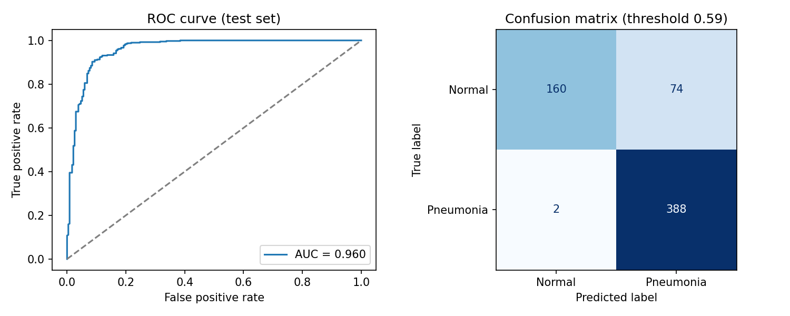

# Chest X-ray Pneumonia Classifier

A ResNet18 model that classifies pediatric chest X-rays as **normal** or **pneumonia**.
The plan is to make it run fast on a normal laptop CPU (ONNX + INT8) and put up a small web demo.

**This is a student project for learning. It is not for medical use.**

## Progress

- [x] Data preparation (patient-level split)
- [x] Baseline model: ResNet18 fine-tuned from ImageNet weights (test AUC 0.960)
- [ ] Grad-CAM to see where the model looks
- [ ] Export to ONNX and quantize to INT8
- [ ] Compare speed and size on CPU
- [ ] Gradio demo

## Results

Official test set (624 images):

| Model | AUC | Sensitivity | Specificity | Accuracy |
|---|---|---|---|---|
| ResNet18 baseline | 0.960 | 0.995 | 0.684 | 0.878 |

Threshold 0.59 (chosen on validation). Out of 390 pneumonia cases the model missed 2;
out of 234 normal cases, 74 were flagged as pneumonia.



What I noticed:

- **Validation vs test gap.** Validation AUC was 0.9995 but test AUC was 0.960. Since train and validation are split
  by patient, this is not leakage — the official test images seem to look different from the training images
  (distribution shift). This is a real problem for medical AI, e.g. when a model moves to a different hospital.
- **Too many false positives on test.** The threshold picked on validation doesn't transfer perfectly, so
  specificity drops to 68%. For screening, missing only 2 sick children is good, but this is something to improve.
- **Learns very fast.** Validation AUC was already 0.9995 after the first epoch, so the validation set is
  almost too easy to compare epochs.

Next I will use Grad-CAM to check whether the model actually looks at the lungs.

## Dataset

[Chest X-Ray Images (Pneumonia)](https://www.kaggle.com/datasets/paultimothymooney/chest-xray-pneumonia) on Kaggle
(Kermany et al., 2018). About 5,800 X-rays of children aged 1–5. The images are not included in this repo.

Some things I had to handle:

- **Same patient, many images.** Some children have several X-rays. If I split by image, the same child could end up
  in both train and validation, and the score would look better than it really is. So I split by patient ID
  (taken from the file name).
- **Tiny validation folder.** The official `val` folder has only 16 images, so I merged it into train and used
  15% of the patients as my validation set. The official test set is kept as it is.
- **Imbalanced classes.** There are about 3 pneumonia images for every normal one, so I used `pos_weight` in the loss
  and report sensitivity and specificity, not only accuracy.
- **No horizontal flip.** The heart is on the left side, so a flipped X-ray is not realistic.

## How to run

Easiest: open `notebooks/train_colab.ipynb` in Google Colab with a GPU.

Or on your own computer:

```
pip install -r requirements.txt
python prepare_data.py     # download data + make splits.csv
python train.py            # train, saves best_model.pt
python evaluate.py         # test results -> results/
```

## Files

- `prepare_data.py` – finds all images and splits them into train / val / test by patient
- `train.py` – dataset, model and training loop
- `evaluate.py` – picks a threshold on validation, then tests on the test set
- `results/` – metrics and plots
